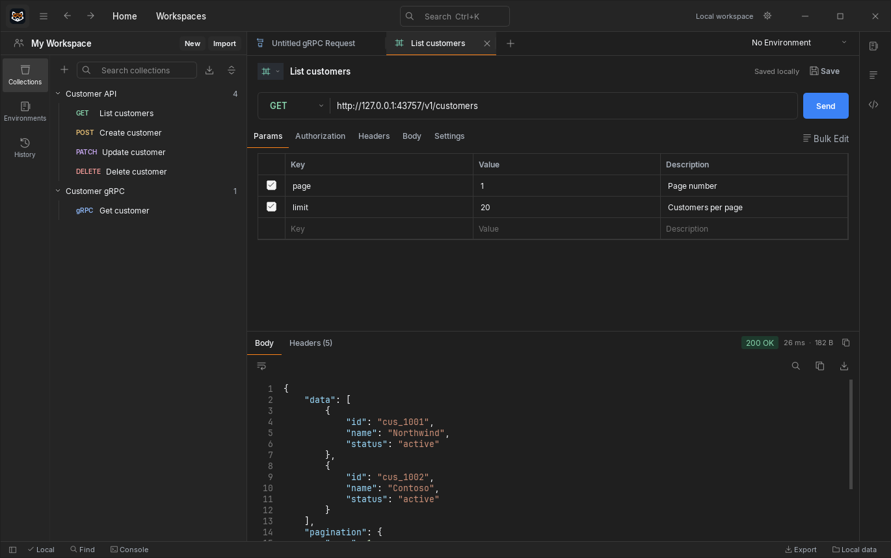

# Reqon

Настольный API-клиент для HTTP и gRPC. Отправляйте запросы, изучайте ответы и сохраняйте рабочие сценарии в коллекциях. Коллекции, окружения, история и настройки хранятся на вашем компьютере; для работы не нужен аккаунт.

Интерфейс построен на Qt Widgets и PySide6. Поддерживаются Windows x64 и Linux x86-64.

[Сайт](https://reqon.ru/) · [Скачать](https://github.com/Norwi4/reqon/releases) · [Документация](https://reqon.ru/docs/) · [Сообщить об ошибке](https://github.com/Norwi4/reqon/issues)



## Возможности

- **HTTP:** методы, query-параметры, заголовки, Bearer / Basic / JWT / API Key, JSON, текст, multipart/form-data, файлы и GraphQL, просмотр тела и заголовков ответа.
- **gRPC:** поиск сервисов через reflection, импорт `.proto` и descriptor set, unary и streaming RPC, metadata, trailers и примеры сообщений по protobuf-контракту.
- **Коллекции и окружения:** папки, переменные `{{name}}`, история запросов, сохранённые примеры ответов, импорт и экспорт коллекций. HTTP-коллекции совместимы с Postman v2.1; для смешанных HTTP/gRPC-коллекций используется формат Reqon.
- **Оформление:** 12 тем с предпросмотром, ручной выбор или синхронизация с системой с отдельными дневной и ночной темами. Интерфейс использует Inter, шрифт редакторов кода настраивается отдельно.
- **TLS:** настройки проверки сертификатов, собственный CA, клиентские сертификаты и переопределение имени сервера для запроса.

Также доступны HTTP/2, локальные cookies, Proxy, импорт cURL/gRPCurl, проверка тела запроса по локальной JSON Schema и раздел General с настройками редактора, языка и автосохранения. HTTP-методы имеют цветовую маркировку; меню поддерживает ввод собственного метода.

Команды cURL/gRPCurl можно редактировать прямо в боковой панели: изменения применяются к текущему запросу автоматически. Вкладка Auth содержит отдельные формы авторизации, а Headers позволяет раскрыть автоматически создаваемые заголовки. Консоль запросов открывается в нижней части окна. Кнопка **Info** показывает версию приложения и ссылку для сообщения об ошибках.

## Скачать

| Платформа | Версия | Установочный файл |
| --- | --- | --- |
| Windows x64 | **0.15.0** | [Скачать EXE](https://github.com/Norwi4/reqon/releases/download/v0.15.0/Reqon-Setup-0.15.0-win64.exe) |
| Linux x86-64, glibc ≥ 2.36 | **0.13.9** | [Скачать TAR.GZ](https://github.com/Norwi4/reqon/releases/download/v0.13.9/Reqon-0.13.9-linux-x86_64.tar.gz) |
| Astra Linux 1.8, amd64 | **0.13.9** | [Скачать DEB](https://github.com/Norwi4/reqon/releases/download/v0.13.9/reqon_0.13.9_astra1.8_amd64.deb) |

Все версии доступны в [GitHub Releases](https://github.com/Norwi4/reqon/releases) и в [архиве на сайте](https://reqon.ru/download/). Для установки выбирайте EXE, TAR.GZ или DEB из раздела **Assets**. Python в готовых сборках уже включён.

На странице каждого релиза есть файл `SHA256SUMS.txt` для проверки скачанных файлов. Пример проверки Windows-установщика:

```powershell
Get-FileHash .\Reqon-Setup-0.15.0-win64.exe -Algorithm SHA256
```

### Windows

Запустите установщик и выберите папку установки. Приложение появится в меню «Пуск»; в мастере можно добавить ярлык на рабочий стол.

Начиная с версии 0.13.3, данные хранятся в `%APPDATA%\Reqon\reqon.sqlite3`. При первом запуске база предыдущего приложения переносится автоматически, а исходная копия сохраняется для восстановления. Обновление приложения не заменяет существующую базу Reqon.

### Linux — переносимая сборка

Распакуйте архив в отдельную папку и запустите приложение:

```sh
tar -xzf Reqon-0.13.9-linux-x86_64.tar.gz
./Reqon/reqon
```

Нужны glibc ≥ 2.36 и графическая среда. Сохраняйте каталог `_internal` рядом с исполняемым файлом; при обновлении распаковывайте архив в новую папку. Данные находятся в `$XDG_DATA_HOME/Reqon` или `~/.local/share/Reqon`.

Используется Qt/PySide6 6.11.3. Архив собирается из того же приложения, что и пакет для Astra Linux 1.8.

### Astra Linux 1.8

```sh
sudo apt install ./reqon_0.13.9_astra1.8_amd64.deb
```

Запускайте приложение из меню или командой `reqon`. Команда `getman` сохранена для совместимости с прежними установками.

## Запуск из исходников

```sh
git clone https://github.com/Norwi4/reqon.git
cd reqon
```

Windows / PowerShell:

```powershell
python -m venv .venv
.venv\Scripts\Activate.ps1
python -m pip install -r requirements.txt
python main.py
```

Linux:

```sh
python3 -m venv .venv
. .venv/bin/activate
python -m pip install -r requirements.txt
python main.py
```

Чтобы использовать отдельный рабочий каталог, передайте `--data-dir`:

```sh
python main.py --data-dir ./workspace
```

## Сборка и проверки

Windows: `powershell -File packaging/build-windows.ps1`. Скрипт создаёт приложение, ZIP-архив и EXE-установщик в `dist/`. Для установщика нужен Inno Setup с компилятором `ISCC.exe`.

Для сборки DEB используйте Linux amd64 и [Dockerfile](packaging/Dockerfile.astra18), либо выполните `bash packaging/build-deb.sh` в подготовленной Astra Linux 1.8. Сценарии упаковки находятся в [packaging/](packaging/).

Проверки приложения используют временные базы и локальные HTTP/gRPC-серверы:

```sh
python -m pip install -r requirements-test.txt
python -X faulthandler -m unittest discover -s tests -p "test_*.py" -v
```

Изменения 0.15.0 описаны в [заметках к выпуску](docs/release-0.15.0.md).
